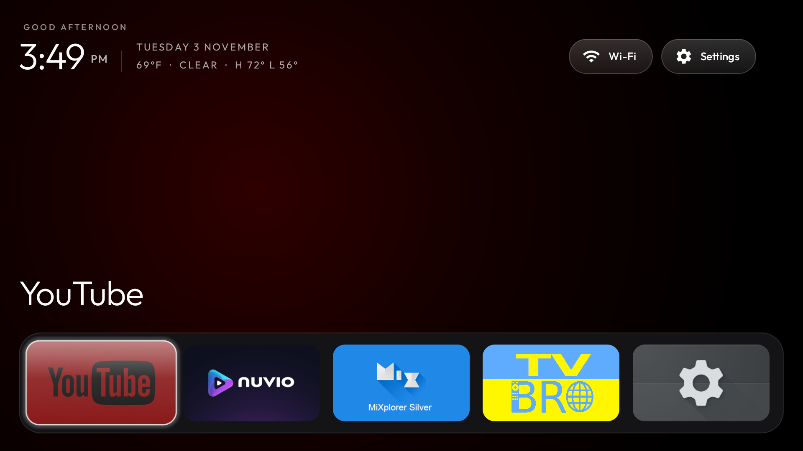
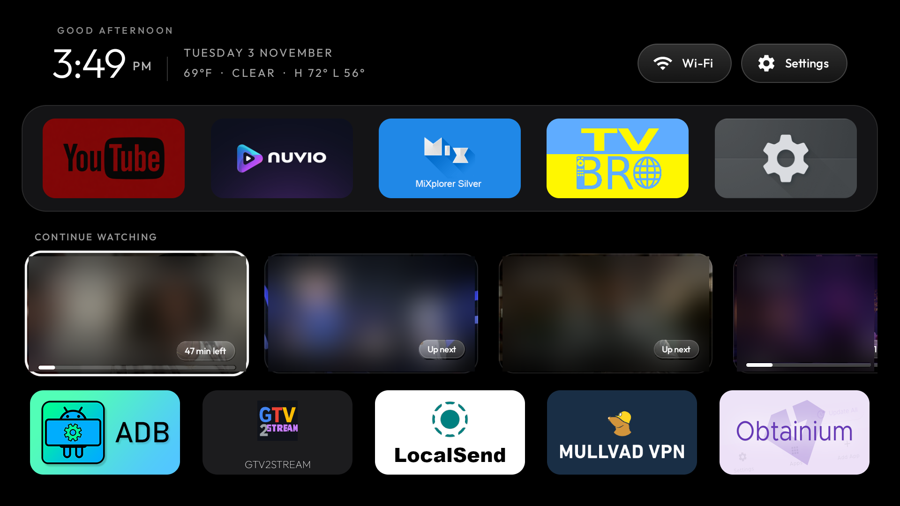
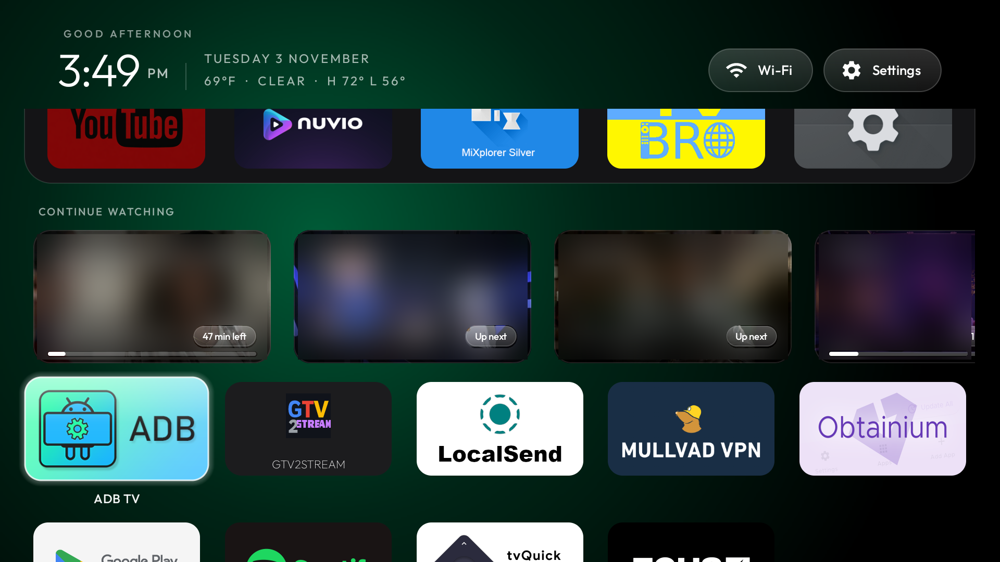
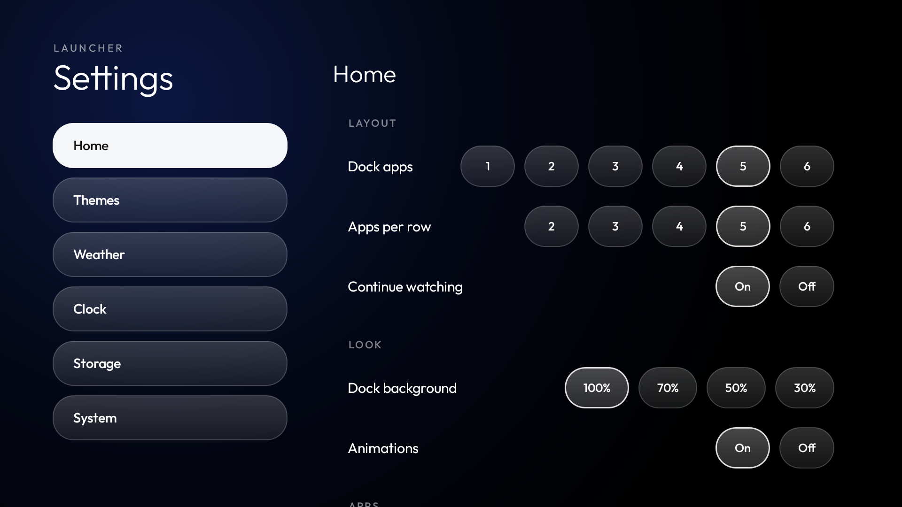
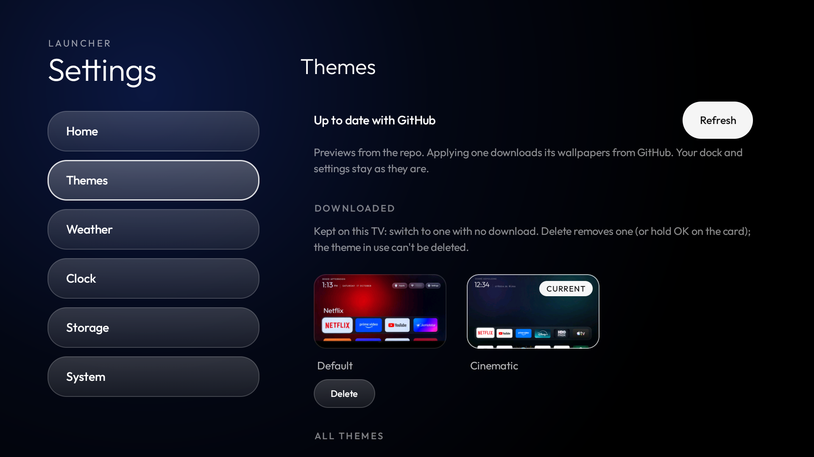
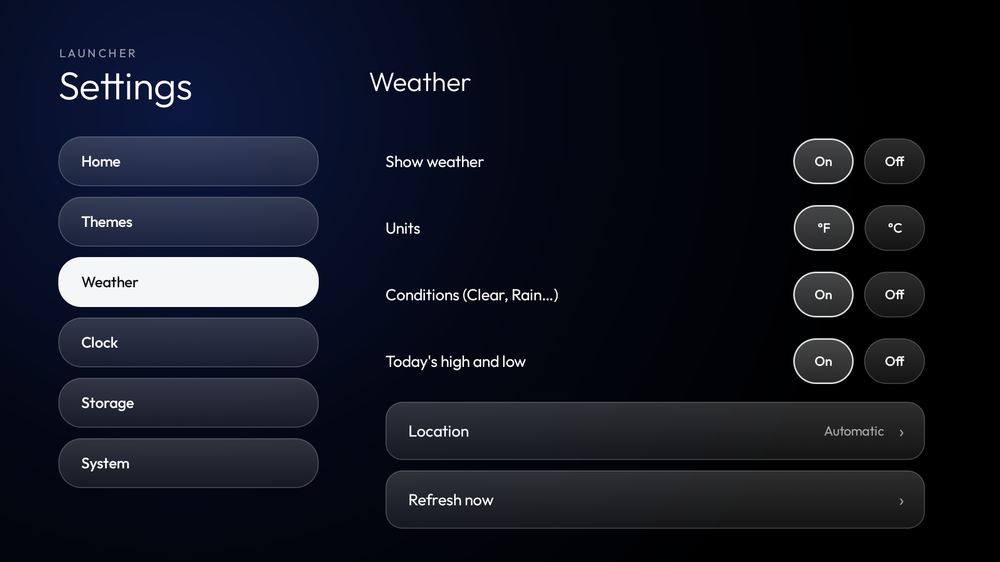
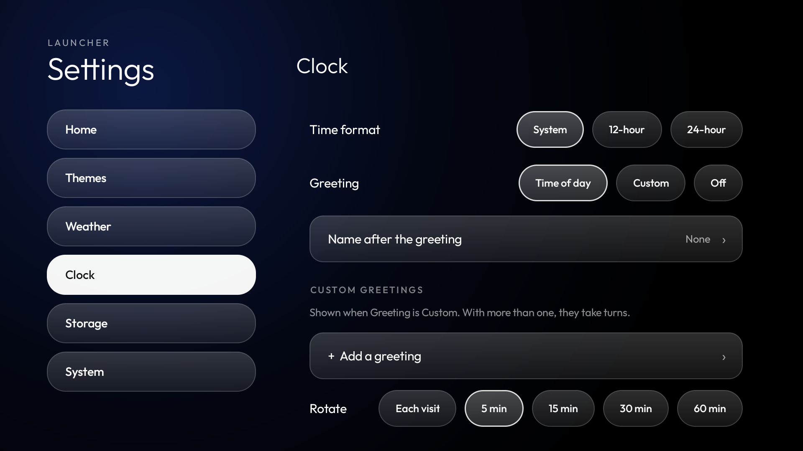
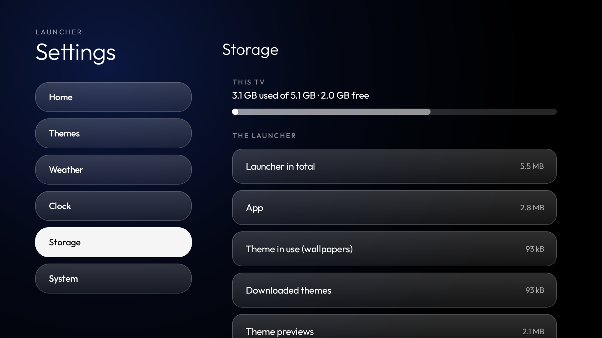

# Apple TV-style home with Continue watching, weather and a Settings menu

A fork of this repo's launcher (`launcher/`), built and tested on an **onn. 4K Streaming Box (2023, YOC), Google TV 14**.
Everything else in the repo (the debloat tools, lists and docs) is unchanged.

## Screenshots

All taken on the onn box. In the Continue watching shots, the titles, episode names and thumbnails are blurred for
privacy; the time-left pills and progress bars are left as they are.

| | |
|---|---|
|  |  |
| **Dock focused**: at the bottom edge, enlarged, the app's name and the clock lined up on its left | **Continue watching**: Down from the dock; thumbnail cards with time left and progress |
|  |  |
| **App grid**: the rows span the dock's width | **Settings > Home**: dock and grid sizes, Continue watching, look |
|  |  |
| **Settings > Themes**: Downloaded (Default first) and every theme in this repo | **Settings > Weather**: units, what to show, location |
|  |  |
| **Settings > Clock**: 12/24-hour, greetings that rotate | **Settings > Storage**: the TV's space and the launcher's share |

## What it adds

**Home**
- The dock sits at the bottom edge of the screen while it has focus, slightly enlarged, with the clock and the focused
  app's name lined up on its left edge. Down glides it up under the clock (eased, about 0.4 s) as it shrinks back and
  the rows below grow; Up reverses it.
- The rows under the dock span exactly the dock's width, 4 across by default (`grid_columns` in `config.xml`).
- While apps are being reordered, a pill at the top says so and that Back ends it.

**Continue watching** (`continue_watching_apps` in `config.xml`, set to Nuvio here)
- A sideways-scrolling row of up to 20 cards under the dock, read from the preview channel the app publishes to the
  TV provider: the episode's thumbnail, the show or film name, season and episode with the episode title, the time
  left and a progress line. OK opens the title in the app.
- Needs `pm grant com.gathin.tvhome android.permission.READ_TV_LISTINGS`. Thumbnails of titles that leave the list are
  deleted from the cache.
- **Only Nuvio for now.** It is the only app this was built and tested with. The row reads Android TV's standard
  preview channels, so other apps that publish their continue-watching list as one (Stremio keeps a "Continue
  Watching" preview channel, see `docs/watch-next.md`) can be added by putting their package in
  `continue_watching_apps`, e.g. `com.stremio.one`. Untested so far; the cards show whatever the app fills in (some
  leave out dates or episode numbers), and support for other apps can be added later.

**Weather** (`weather` in `config.xml`)
- A line under the date on Home and on the clock screensaver: temperature, conditions, today's high and low.

**Settings menu** (the top bar's Settings button; Android's settings stay a long press away and under System)
- Home: dock apps 1–6, apps per row 2–6, Continue watching on/off, dock background, animations, reorder.
- Themes: previews of every theme in this repo's `themes/`, applied in place. Applied themes are kept on the TV under
  Downloaded (Default first) and can be deleted, except the one in use. A bold status line with a Refresh button.
- Weather: on/off, °F/°C, conditions and high/low on/off, location by city search, refresh.
- Clock: 12/24-hour, greeting by time of day, custom greetings that rotate (each visit, or every 5–60 minutes), or off.
- Storage: the TV's free space and what the launcher uses, by part, with clean-up buttons.
- System: Android TV settings, network, apps, screensaver, default home app.

## Network use

Unlike the upstream launcher, this fork has the `INTERNET` permission. It is used only for:

| What | Where | When |
|---|---|---|
| Weather location | `ipwho.is` (the public IP's city; with a VPN up, the VPN server's) | At most once a day, unless a city is picked in Settings |
| Weather | `api.open-meteo.com` | At most every 30 minutes, only while Home or the screensaver is on screen |
| City search | `geocoding-api.open-meteo.com` | Only when searching in Settings > Weather |
| Theme list | `raw.githubusercontent.com` (themes README), `api.github.com` (repo tree) | Only on opening the Themes page or pressing Refresh, at most every 10 minutes; the API only when the README changed, or once a day |
| Theme previews and wallpapers | `raw.githubusercontent.com` | When a preview changed, or a theme is applied |
| Continue watching thumbnails | The image URLs the app publishes (https only, 4 MB cap, cached up to 40 MB) | When a new title appears |

No accounts, keys, analytics or background services: nothing is fetched while Home is not on screen.

## Build and install

As upstream: `launcher/build-and-install.sh` (or `.ps1` on Windows), then grant the Continue watching permission
above. The theme previews are bundled into the APK at build time from `themes/` (the `bundleThemes` task in
`launcher/app/build.gradle`), which puts the APK at about 2.7 MB, above upstream's 576 KB gate.
