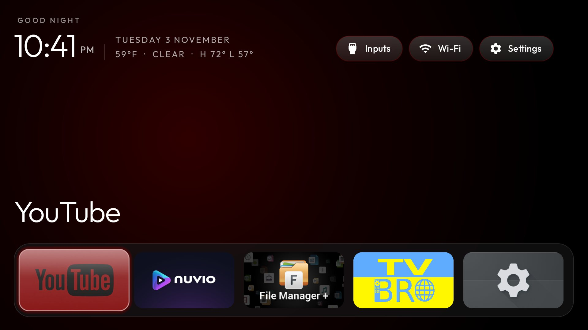
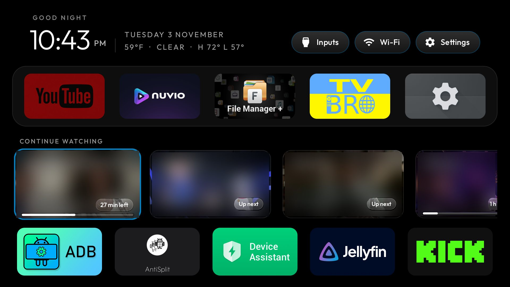
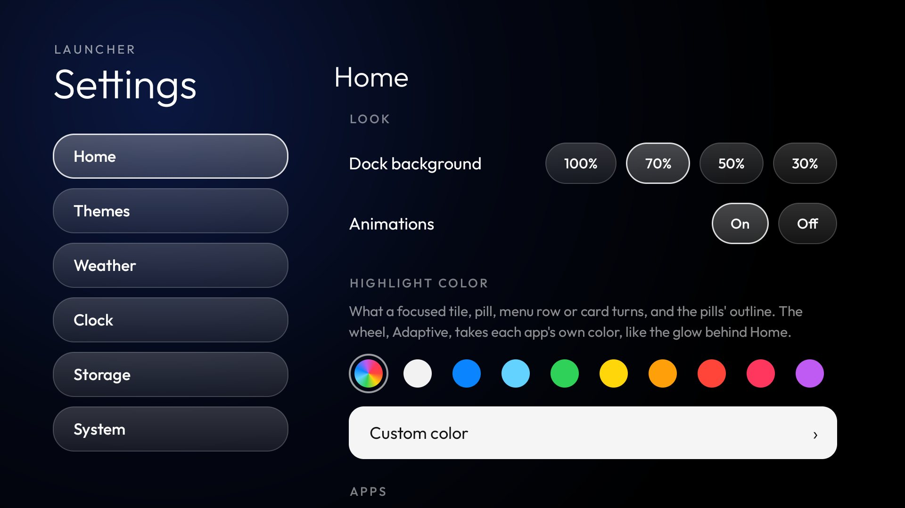
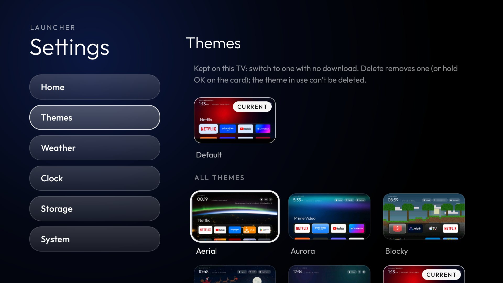
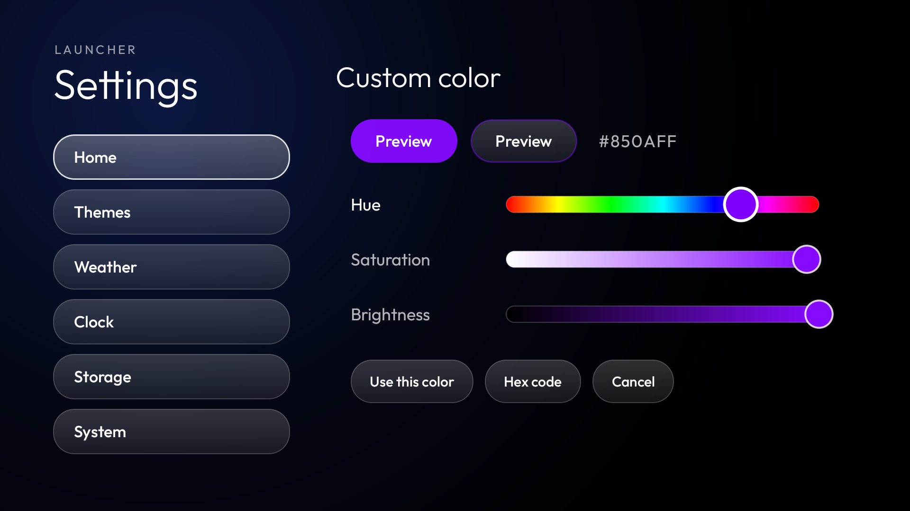

# Apple TV-style home with Continue watching, weather, a Settings menu and highlight colors

A fork of this repo's launcher (`launcher/`), built and tested on an **onn. 4K Streaming Box (2023, YOC), Google TV 14**
and a **Hisense SmartTV 4K (songshan), Android 11**. Everything else in the repo (the debloat tools, lists and docs) is
unchanged.

## Screenshots

The full gallery is at the top of [README.md](README.md): the Adaptive highlight on several apps, the menus, Continue
watching, the app grid, the reorder banner, the screensaver and every Settings page. All were taken on the Hisense;
in the Continue watching shots the titles, episode names and thumbnails are blurred for privacy.

| | |
|---|---|
|  |  |
| **Continue watching** | **Highlight color** |
|  |  |
| **Themes** | **Custom color** |

## What it adds

**Home**
- The dock sits at the bottom edge of the screen while it has focus, slightly enlarged, with the clock and the focused
  app's name lined up on its left edge. Down glides it up under the clock (eased, about 0.4 s) as it shrinks back and
  the rows below grow; Up reverses it.
- The rows under the dock span exactly the dock's width, 4 across by default (`grid_columns` in `config.xml`).
- While apps are being reordered, a pill under the top bar says so and that Back ends it.

**Continue watching** (`continue_watching_apps` in `config.xml`, set to Nuvio here)
- A sideways-scrolling row of up to 20 cards under the dock, read from the preview channel the app publishes to the
  TV provider: the episode's thumbnail, the show or film name, season and episode with the episode title, the time
  left and a progress line. OK opens the title in the app.
- Needs `pm grant com.gathin.tvhome android.permission.READ_TV_LISTINGS`. Thumbnails of titles that leave the list are
  deleted from the cache.
- **Only Nuvio for now.** It is the only app this was built and tested with. The row reads Android TV's standard
  preview channels, so other apps that publish their continue-watching list as one (Stremio keeps a "Continue
  Watching" preview channel, see `docs/watch-next.md`) can be added by putting their package in
  `continue_watching_apps`, e.g. `com.stremio.one`. Untested so far; the cards show whatever the app fills in (some
  leave out dates or episode numbers), and support for other apps can be added later.

**Weather** (`weather` in `config.xml`)
- A line under the date on Home and on the clock screensaver: temperature, conditions, today's high and low.

**Settings menu** (the top bar's Settings button; Android's settings stay a long press away and under System)
- Home: dock apps 1–6, apps per row 2–6, Continue watching on/off, dock background, animations, reorder, and the
  highlight color.
- Highlight color: what a focused tile's glass, a pill, a menu row and a Continue watching card turn, and the pills'
  outline. Swatches for white (the default), eight presets and **Adaptive**, which takes each focused app's own
  color, sampled from its banner like the glow behind Home. **Custom color** has hue, saturation and brightness
  sliders made for the remote (Left/Right, hold to go faster), a live preview, and a hex code field. Text on a
  light color turns dark.
- Themes: previews of every theme in this repo's `themes/`, applied in place. Applied themes are kept on the TV under
  Downloaded (Default first) and can be deleted, except the one in use. A bold status line with a Refresh button.
- Weather: on/off, °F/°C, conditions and high/low on/off, location by city search, refresh.
- Clock: 12/24-hour, greeting by time of day, custom greetings that rotate (each visit, or every 5–60 minutes), or off.
  **Screensaver** (ScreensaverStyle, ClockScene): a live preview of the clock screensaver above its options; when it
  starts (Android's own timer, 5 minutes to 2 hours: needs `appops set com.gathin.tvhome WRITE_SETTINGS allow`,
  which build-and-install grants); the clock moving around (as before) or fixed on one of nine spots; the date and
  the weather with the clock, on a spot of their own, or off; a size for each (S, M, L, XL); the glow behind them
  changing colours (as before), one custom colour, or off, from one to four points of light; and the real
  screensaver full screen.
- Storage: the TV's free space and what the launcher uses, by part, with clean-up buttons.
- System: three rows, each opening its own page. ATV settings: Android TV settings, network, apps, screensaver, default home app. Language: the TV's, or any of 32 (English, Spanish, Japanese and every language upstream's launcher has), covering this fork's pages too. The APK carries English only (resourceConfigurations); the others download on demand from this branch's res/values-*/ files (LanguagePacks), split into Installed and Not installed (a download lands in Installed; picking it again switches), and Storage > Languages removes them. Updates: Check for updates, Install update and the installed version at the top; how often to check this fork for a new launcher (off, 1, 3, 6, 12 or 24 hours; 1 by default) below.

**Updates** (`Updates.java`)
- Builds are published as GitHub releases of this fork, tagged `launcher-<versionCode>`, with the APK as `cleanyourtv-launcher.apk` and `sha256: <hex>` in the notes. The version code is the branch's commit count (`launcher/app/build.gradle`).
- The launcher checks at boot, when Home comes back after the interval (so also after standby), and on an inexact alarm every interval. A newer release is offered once on Home and stays under Settings.
- Installing downloads the APK, checks its size and SHA-256, and opens Android's installer for one press of Install. It needs `appops set com.gathin.tvhome REQUEST_INSTALL_PACKAGES allow` (or allowing the launcher under Install unknown apps), and an APK signed with the same key as the installed launcher.

**Remote buttons for one TV** (`device.json`, beside a theme's `config.json` in the launcher's files folder)
- Remote-key settings that belong to one TV, not a theme: `settings_key_keycodes`, `settings_key_panel`, `app_keys`,
  `key_filter`, `consume_volume_keys` and `restore_key_services` win over config.xml and the theme. Applying a theme
  leaves the file alone and resets no on-TV choices. Without the file nothing changes.
- `settings_key_broadcast`: a firmware broadcast that reports each remote key in an int extra `keycode`;
  HomeKeyService opens Settings when it reports one of `settings_key_keycodes`. Hisense songshan (Android 11) sends
  `com.hisense.INTERCEPT_BUTTON_OPERATING` for every key. Its volume handler takes Volume Up/Down before any key
  filter, so a filtering helper never sees them and held volume stops repeating. That TV runs the helper without the
  filter, and its gear button (keycode 83, for the disabled Google TV home) comes through the broadcast:
  `{"settings_key_keycodes": [83], "settings_key_panel": true, "key_filter": false,
  "settings_key_broadcast": "com.hisense.INTERCEPT_BUTTON_OPERATING"}`, with HomeKeyService enabled.
- Install it with `HOME_KEY_SERVICE=1 DEVICE_JSON=<file> launcher/build-and-install.sh` (Windows:
  `-HomeKeyService -DeviceJson <file>`). PROMPT.md walks through finding the values, with a real press of each button.
- The panel's Launcher settings row goes back to Home and opens this fork's Settings menu.

## Network use

Unlike the upstream launcher, this fork has the `INTERNET` permission. It is used only for:

| What | Where | When |
|---|---|---|
| Weather location | `ipwho.is` (the public IP's city; with a VPN up, the VPN server's) | At most once a day, unless a city is picked in Settings |
| Weather | `api.open-meteo.com` | At most every 30 minutes, only while Home or the screensaver is on screen |
| City search | `geocoding-api.open-meteo.com` | Only when searching in Settings > Weather |
| Theme list | `raw.githubusercontent.com` (themes README), `api.github.com` (repo tree) | Only on opening the Themes page or pressing Refresh, at most every 10 minutes; the API only when the README changed, or once a day |
| Theme previews and wallpapers | `raw.githubusercontent.com` | When a preview changed, or a theme is applied |
| Continue watching thumbnails | The image URLs the app publishes (https only, 4 MB cap, cached up to 40 MB) | When a new title appears |
| Nuvio suggestions | `v3-cinemeta.strem.io` (Nuvio's default catalog: popular movies and series), `images.metahub.space` (backdrops and logos, https only, cached on the TV) | The lists at most every 6 hours, a picture the first time its title is shown; only while the dock has focus, and only with Settings > Home > Nuvio suggestions on (on by default when a Nuvio app is installed). Not in the offline build |
| Update check | `api.github.com` (this fork's latest release) | At boot, when Home returns after the interval, and every interval (1 hour by default); never with checks off |
| Update download | `github.com` release asset (32 MB cap, SHA-256 checked) | Only when Install update is chosen |

No accounts, keys or analytics. Apart from the update check (an alarm at the chosen interval), nothing is fetched while Home is not on screen.

**Offline build** (`-PlauncherNetwork=offline`, `BuildConfig.OFFLINE`): goes online only for the update check and
download. No weather (the line, the Settings page and city search are left out), no Continue watching images (the
cards keep the app's banner), no theme list from GitHub (Themes lists Default, themes kept on the TV, and theme
folders copied to `Android/data/com.gathin.tvhome/files/themes/<name>/` in the repo's `themes/` layout), and every
language built into the APK instead of downloaded (about 0.5 MB more). Settings > System shows "· Offline" after the
version. Each release carries both builds, `cleanyourtv-launcher.apk` and `cleanyourtv-launcher-offline.apk`, with
`sha256:` and `sha256-offline:` lines; **Update channel** under Settings > System > Updates picks which one updates
install, and switching offers the other build of the latest version at once.

## Build and install

As upstream: `launcher/build-and-install.sh` (or `.ps1` on Windows), then grant the Continue watching permission
above. The theme previews are bundled into the APK at build time from `themes/` (the `bundleThemes` task in
`launcher/app/build.gradle`), which puts the APK at about 2.7 MB, above upstream's 576 KB gate.
